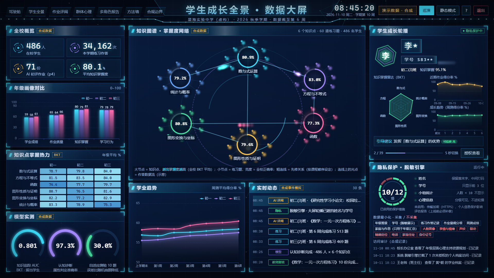

> **AI 教学演示案例 / AI Teaching Demos** 系列

# 学生成长全景评价平台（展示版）：知识追踪、认知诊断、自适应测验与隐私保护的数据大屏

**Shuyao Gao**（gaoshuyao.mk@gmail.com）· aSSIST University (Seoul School of Integrated Sciences and Technologies) · 서울과학종합대학원대학교
代码 MIT · 文档与教学素材 CC BY 4.0，使用请注明出处。

一个打开就能看的“学生成长全景评价”数据大屏与分析平台：在一所**虚构学校的合成数据**上，真实训练并展示知识追踪（BKT / PFA / DKT-lite）、认知诊断（DINA + Q 矩阵）、项目反应理论与自适应测验（2PL IRT + CAT），再加上学生、老师、家长、学校领导、教育局五类角色的分级报告、带论文出处的方法墙，以及隐私保护与合规边界（姓名学号打码、分级可见、小格子抑制、访问审计）。适合教育测量、学习分析、数据可视化、可信 AI 等课程做课堂演示。

> ⚠️ **页面上的学校、学生、成绩、作答记录全部是程序按固定随机种子生成的合成数据，仅作概念演示**（虚构学校“星海实验中学（虚构）”）。界面右上角一直显示“演示数据 · 合成”。本项目不使用任何真实学生数据，不处理人脸、视频或语音，不调用摄像头或麦克风。

**English summary.** *Student Evaluation Dashboard Lab* is a static, offline-capable teaching demo (Chinese UI) of a "whole-student evaluation" dashboard built entirely on **synthetic data** for a fictional school. Models are actually fitted on the synthetic data in Python (numpy): Bayesian Knowledge Tracing, PFA and a small DKT-style RNN for knowledge tracing; the DINA cognitive diagnosis model with a Q-matrix; 2PL IRT calibration and a computerized adaptive test (CAT) that you can take yourself in the browser. On top of that are role-based reports for students, teachers, parents, school leaders and the education bureau with different levels of detail, a "methods wall" with verified literature references and maturity labels, and a compliance page quoting verified statutory texts (EU AI Act, GDPR, PRC Personal Information Protection Law, etc.). Privacy is a design goal: names and IDs are masked on the big screen, mental-health information is only shown at group level, small cells (< 10 people) are suppressed, and emotion/face recognition appears only as a disabled-by-default concept animation. A 16-stop auto tour and a static (no-animation) mode are included. No backend, no CDN, works from GitHub Pages or by double-clicking `app/index.html`.



## 怎么打开：不用安装任何东西

- **在线打开**：<https://shuyaogao.github.io/student-eval-dashboard-lab/>（GitHub Pages）。
  - 打开即巡演（无人值守循环播放）：<https://shuyaogao.github.io/student-eval-dashboard-lab/app/index.html?tour>
  - 静态模式（关闭动画，给配置较低的电脑用）：<https://shuyaogao.github.io/student-eval-dashboard-lab/app/index.html?static>
- **下载到电脑**：点 **Code → Download ZIP**，解压后双击 **`app/index.html`**，用系统自带的 Edge 或 Chrome 打开。不需要 Python、不需要联网。
- Windows 上也可以双击根目录的 `启动演示.bat`：Edge 全屏打开数据大屏并自动巡演（`启动演示.bat static` 为静态模式）。

页面为 1920×1080 投影设计，在电脑上 1920×1080 与 1366×768 下验证过；手机上可以打开浏览，但不是为手机竖屏设计的。

## 怎么用

- **打开时默认进入数据大屏**：固定 1920×1080 设计稿，等比缩放填满窗口。知识图谱主视觉（6 个知识点 + 60 道练习题，亮度 = 掌握度 / 正确率）、依次入场的图表、学生成长轮播（姓名学号打码）、隐私保护面板、合成的实时动态。
- 首次打开会弹出操作说明和“推荐汇报路线”（看过的模块自动打勾），之后按 <kbd>H</kbd> 或右上角 `?` 再打开。
- 顶部标签切换模块：<kbd>0</kbd> 数据大屏，<kbd>1</kbd>–<kbd>7</kbd> 其余 7 个页面；<kbd>B</kbd> 投影比例（左右两栏 45:55 → 35:65）；<kbd>S</kbd> 静态模式；<kbd>P</kbd> 自动巡演（16 站覆盖全部模块，大屏停 30 秒、其余页面 9–18 秒，长页面自动缓慢滚动，一轮约 3 分半）。
- 系统设置了“减少动态效果”时默认就是静态模式；页面切到后台时动画和轮播暂停。
- 右上角“退出”会停止全部动画与计时器，并显示结束页。

| 模块 | 给谁看 | 内容 |
|---|---|---|
| 数据大屏 | 展会 / 投影 | 知识图谱、年级画像、知识点热力、模型实测仪表、学业趋势、实时动态（合成事件）、学生轮播（打码，“授权查看”写入访问审计）、隐私保护面板（脱敏规则、数据最小化、已启用的保护措施 10/12 项，未实现的 2 项如实列出） |
| 驾驶舱 | 学校领导 | 全校画像：学业、作业质量、知识掌握度、心理健康群体风险（年级层面）、课堂参与度（概念），年级与 12 个班对比。只有汇总 |
| 学生全景 | 老师 | 雷达图与成长曲线；知识追踪（掌握概率随时间变化）；认知诊断（DINA + Q 矩阵）；10 题自适应测验（可以自己作答）；带证据和可信度的引导建议；评语示例 |
| 作业评阅 | 老师 / 家长 | 拍照上传 → 预处理 → AI 初评 → 教师复核 → 家长看到结果 → 画像更新（作业智评演示系统的截图，作业图片是程序合成的仿手写图）；5 套量规；合规闸门 |
| 群体心理 | 学校领导 / 心理老师 | 证据森林图、判别力上限（AUC 梯子）、“前 20% 名单”的误报与漏报、贴标签风险、年级层面的资源规划 |
| 多角色报告 | 五类角色 | 学生 / 老师 / 家长 / 学校领导 / 教育局五个视图，信息粒度不同；每个视图都能导出一页报告（打印或另存为 PDF） |
| 方法墙 | 所有人 | 18 张方法卡片：一句话说明、在本平台用在哪、已核实的论文出处、成熟度（已在本演示中实现 / 概念演示 / 仅研究阶段）；多模态学习分析只用合成信号做抽象动画 |
| 合规边界 | 所有人 | 数据目录（可以用什么、需要谁同意）、禁止用途、本平台默认设置、信息可见范围，以及 22 条逐字核实的法规条款 |

## 课堂上怎么用

- 讲教育测量 / 学习分析：从“学生全景”切换知识追踪、认知诊断、自适应测验三种证据，看它们如何互相印证；让同学自己做一遍 10 题自适应测验，看能力估计和置信区间如何随作答收窄。
- 讲可信 AI / 数据伦理：从“多角色报告”看同一套数据在五种角色下的粒度差异，再看“合规边界”和方法墙里情绪识别卡片为什么默认关闭。
- 投影或展台：用 `?tour` 链接无人值守循环播放。汇报讲法、演示顺序和排障见 [`DEMO_GUIDE.md`](DEMO_GUIDE.md)。
- 项目背景与设计决定见 [`REQUIREMENTS.md`](REQUIREMENTS.md)：课堂上曾提出包括人脸 / 情绪识别在内的多种评价需求；本项目只用合成数据做概念演示，并把隐私保护作为设计目标。

## 它是怎么做的

`python -m p9 build` 一条命令：生成合成学校 → 跑全部模型 → 写 `results/` → 组装 `app/`。页面上的模型指标一律从 `results/2026-10-14/result.json` 经 `app/data.js` 读取，不在 JS 里手写数字。

关键结果（全部在合成数据上计算，数字来自 `results/2026-10-14/result.json`）：

| 方法 | 指标 | 数值 |
|---|---|---|
| 知识追踪（预测下一题对错，134 名留出学生、9,554 次作答） | AUC：基线 / PFA / BKT / DKT-lite / 生成机制上限 | 0.523 / 0.791 / 0.801 / 0.774 / 0.867 |
| 认知诊断 DINA（486 人 × 24 题 × 6 属性） | 属性判定准确率 / 全部属性判对 / 与 BKT 一致 | 97.3% / 87.4% / 91.2% |
| IRT 题库标定（120 题，2,086 名合成考生） | 区分度 a、难度 b 与真值的相关 | 0.925、0.993 |
| CAT（1,000 名模拟考生，10 题） | RMSE：自适应 / 随机抽题；自适应 95% 区间覆盖率 | 0.387 / 0.553；93.9% |

**怎么读这些数字**：合成作答是按“带个体差异的 BKT”生成的，BKT 与生成机制同族，所以 AUC 偏乐观；DKT-lite 只是 1,638 个参数的单层 RNN（numpy 实现），不是原论文的 LSTM。这些数字说明“方法实现正确、在理想条件下能做到什么”，**不是**真实课堂上的准确率。

“群体心理”和“作业评阅”两页复用了作者另外两个（未公开的）课程项目的汇总结果，页面上分别标为 p3、p4，快照在 `data/sources/`：

- **p3（学生心理健康的群体风险）**：文献证据汇总、校准仿真和开放数据检验的**汇总数字**（不含任何个体记录）。例如个体区分力上限 AUC 0.714（合成），真实开放数据上 0.570；按风险取前 20% 的名单中 52.9% 并非筛查阳性。所以心理健康部分**只做群体层面的资源分配**，个人只有“建议关注 / 普通”两档且只在教师视图出现，不进入任何排名。
- **p4（作业智评）**：演示系统的截图、量规和演示班数据；作业图片是用电脑字体渲染的仿手写合成图，评分是离线规则模拟（mock），“教师复核”也是模拟的。

论文出处用 `tools/verify_refs.py` 核实（记录在 `data/refs_verified.json`），法规条款用 `tools/verify_legal.py` 与官方原文逐字比对（`data/legal_verified.json`），核实不了的标 `[未核实]`。

## 想自己修改或重新生成

```bash
python -m venv .venv
.venv/Scripts/pip install numpy pandas scikit-learn scipy pyyaml playwright pytest   # macOS / Linux 用 .venv/bin/pip
.venv/Scripts/python -m p9 build --offline     # 用 data/sources/ 里的快照，约 10 秒
.venv/Scripts/python -m pytest -q              # 测试；浏览器验收用本机的 Edge（Playwright channel="msedge"）
.venv/Scripts/python tools/browser_check.py --shots <目录>   # 单独跑浏览器验收并截图
```

页面源文件在 `web/`，构建时复制到 `app/`。新增 `web/` 文件要在 `web/index.html` 里加 `<script src>`（为了 `file://` 双击可用，不用 module、fetch、CDN）。

## 目录

```
app/                生成的静态页面（双击 index.html；GitHub Pages 打开的也是它）
web/                页面源文件（原生 JS + SVG/canvas；数据大屏用本地的 ECharts 5.6.0）
p9/                 Python 包：python -m p9 build
  synth.py          合成学校生成器（固定种子；生成机制写在文件头）
  kt.py             BKT（EM）、PFA、DKT-lite（numpy RNN，手写反向传播）
  cdm.py            DINA（EM）与 Q 矩阵
  irt_cat.py        2PL 题库标定（Bock–Aitkin EM）、EAP、最大信息量 CAT
  guidance.py       引导建议规则引擎与评语模板
  analysis.py       把合成数据跑过全部模型，产出 result 与页面数据
  screen.py         数据大屏：知识图谱、打码后的轮播数据、合成事件与审计、保护措施清单
  methods.py、legal.py、refs.py   方法墙文字、法规条款（逐字摘录 + 官方链接）、论文出处
data/sources/       p3 / p4 汇总快照
results/2026-10-14/ result.json、_env_stamp.json、raw/*.jsonl
tests/              pytest（含 Edge 无头浏览器验收）
tools/              浏览器验收、出处与条款核实脚本
demo/screenshots/   截图
DEMO_GUIDE.md       演示与汇报指南
REQUIREMENTS.md     项目背景与设计决定
```

## 常见问题

- **数据是真的吗？** 不是。全部学生、学校、成绩、作答记录都是程序生成的合成数据，仅作概念演示。
- **能识别学生情绪 / 预测哪个学生有心理问题吗？** 不能，也不打算这样做。情绪识别只是一段抽象的概念动画，默认关闭；心理部分只做群体层面。
- **评语是大模型写的吗？** 不是。评语是模板拼接的示例，页面同时展示“将发给大模型的结构化提示”，但没有调用任何大模型。
- **关掉标签页会留下什么吗？** 不会。这是纯静态网页，没有后台进程，关掉标签页就全部结束；只在浏览器本地存储里记住“是否看过说明”“静态模式”等偏好。

## 许可证与引用

- 代码：MIT（[`LICENSE`](LICENSE)）；文档与教学素材：CC BY 4.0（[`LICENSE-docs`](LICENSE-docs)）。使用请注明出处，引用格式见 [`CITATION.cff`](CITATION.cff)。
- 第三方组件（Apache ECharts 5.6.0，Apache-2.0）和引用的法规原文见 [`THIRD_PARTY.md`](THIRD_PARTY.md)。

## AI 辅助开发声明

代码由 Claude Code 辅助编写，经作者审阅。页面上的论文出处和法规条款都经过脚本核实，模型指标全部来自 `results/` 下的计算结果。
